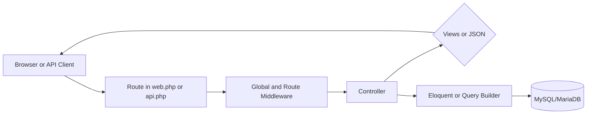
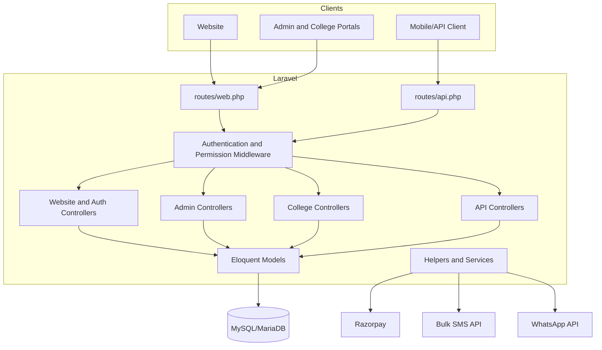
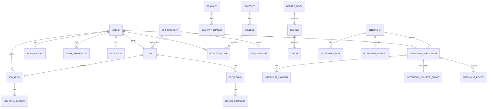
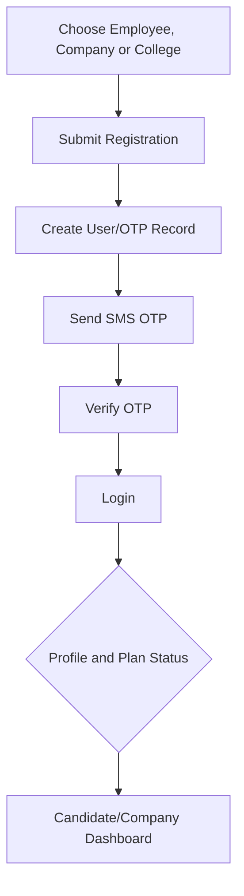
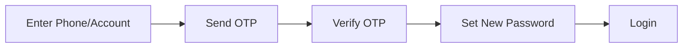
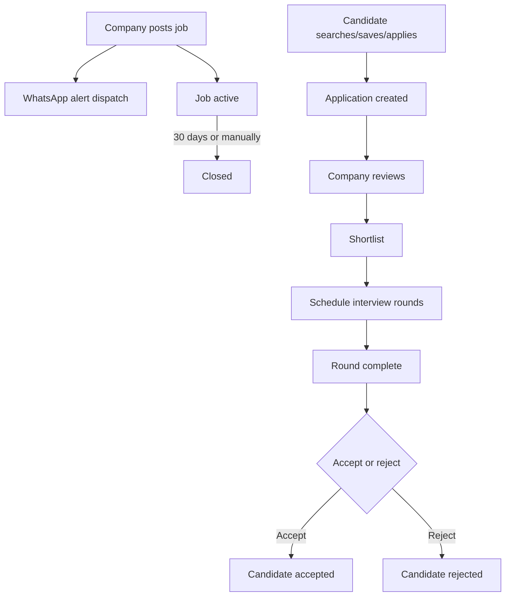
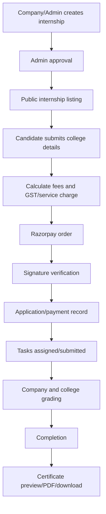
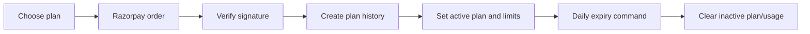

# Zobpot Project Documentation

**Documentation status:** Verified from the repository as of 2026-11-24. It distinguishes implemented behavior from configuration assumptions and recommendations.

## 1. Project Overview

### Project name
Zobpot

### Project description
Zobpot is a Laravel-based recruitment and internship platform for employees/candidates, companies, colleges, college staff, administrators, and interns. It includes public job and internship listings, candidate and company profiles, applications, payment processing, interviews, internship tasks and grading, certificates, plans, and administration.

The web application uses Blade server-rendered views and custom JavaScript/JSON endpoints. A mobile/API-facing Laravel API is also implemented with Laravel Sanctum support.

### Project purpose
- Connect candidates and companies for job opportunities.
- Enable companies to publish, manage, and shortlist jobs.
- Manage internship postings, applications, payments, tasks, assessments, and certificates.
- Provide colleges and college staff with student, internship, marks, and certificate workflows.
- Give administrators tools for users, plans, master data, permissions, settings, and reporting.

### Business objectives
- Automate candidate, company, and internship registration.
- Support paid and free plan limits for jobs and internships.
- Provide structured application and interview status tracking.
- Support paid internship registration through Razorpay.
- Automate WhatsApp alerts and selected operational notifications.
- Provide academic marking and downloadable certificates.

### Target users
- Candidates/employees seeking jobs and internships.
- Companies recruiting candidates or offering internships.
- Colleges and authorized college staff.
- Super administrators and staff users with role/permission assignments.

### Problems solved
- Centralizes recruitment and internship operations.
- Replaces separate candidate/employee application tracking with structured records.
- Connects candidates, companies, college workflows, and administrator approvals.
- Tracks job and internship capacity, status, application progress, marks, feedback, and completion.
- Provides plan usage and expiry handling.

## 2. Technology Stack

| Area | Verified technology |
|---|---|
| Programming language | PHP 8.1.34 (runtime observed); composer constraint PHP `^8.0.2` |
| Backend framework | Laravel 9.52.20 (`laravel/framework` constraint `^9.19`) |
| Frontend | Blade templates, HTML, CSS, vanilla JavaScript, Axios |
| JavaScript build | Vite 4.0.0, laravel-vite-plugin 0.7.2 |
| JavaScript libraries | Axios 1.1.2, Lodash 4.17.19 |
| Admin UI | Public admin assets, likely Sneat/Master-style layout, Bootstrap CSS/JS, ApexCharts, DataTables, Perfect Scrollbar, Typeahead, Select2, Tagify, Bootstrap Select, SweetAlert2, Toastr |
| Website CSS | Custom compiled CSS under `public/assets/css`; Font Awesome |
| Database | MySQL/MariaDB-compatible configuration; default `.env.example` uses MySQL |
| Package manager | Composer and npm |
| PDF | barryvdh/laravel-dompdf 2.2.0 |
| Payments | Razorpay SDK 2.9.2 |
| HTTP/API | Guzzle 7.9.3 and Laravel HTTP client |
| Images | Intervention Image 2.7.2 |
| Authorization | Spatie Laravel Permission 6.20.0 |
| Tables | Yajra Laravel DataTables 10.11.4 |
| API authentication | Laravel Sanctum 3.3.3 |
| Development tools | Laravel Tinker, Pint 1.5.0, Sail 1.43.1, PHPUnit 9.6.23, Collision 6.4.0, Faker, Mockery |

The repository contains no confirmed deployment container or CI configuration for production. Docker/Sail files are dependencies and not proof of an active deployment setup.

## 3. Project Architecture

### Application architecture
The application follows a Laravel MVC architecture with Blade views and direct controller-to-Eloquent/query-builder database access. Dedicated services and helpers implement selected cross-cutting behavior:
- `app/Services/` for WhatsApp job notifications.
- `app/Helpers/` for payments, SMS, and WhatsApp.
- `app/Jobs/` for queued WhatsApp notifications.
- Artisan commands for jobs and plans.

A formal repository or domain-service layer is not used consistently. Most business logic resides in controllers.

### MVC implementation
- Routes: `routes/web.php`, `routes/api.php`.
- Controllers: `app/Http/Controllers/`.
- Models: `app/Models/`.
- Views: `resources/views/`.
- Public assets: `public/`.
- Configuration: `config/`.
- Database migrations: `database/migrations/`.

### Main folders
```text
app/
  Console/Commands/       Scheduled cleanup and plan expiry commands
  Helpers/                Payment, SMS, WhatsApp integration
  Http/Controllers/       Admin, API, Auth, College, Website controllers
  Http/Middleware/        Authentication and permission middleware
  Jobs/                   Queued WhatsApp notification
  Models/                 Eloquent models
  Services/               WhatsApp notification service
database/
  migrations/             Schema changes
  seeders/                Database seeder entry point
public/                   Browser assets and uploaded files
resources/views/          Blade templates
resources/js/             Vite entry files
routes/                   Web, API and console routes
tests/                    Placeholder unit/feature tests
config/                   Laravel configuration
```

### Request lifecycle


For web requests, the `web` middleware group provides cookies, sessions, CSRF protection, and route binding. API requests use API throttling and route binding. Additional guards and permission middleware are applied to relevant routes.

### Architecture diagram


### Frontend/backend communication
- Blade views generate server-rendered HTML.
- DataTables and Ajax/Fetch-style POST requests load tabular data.
- JSON responses are used by website, admin, and API flows.
- Axios is configured for the Vite stack and includes `X-Requested-With`.
- Vite assets are built with `npm run dev` or `npm run build`; much of the UI uses assets copied directly under `public/`.

## 4. User Roles and Permissions

### Authentication roles
The code distinguishes:
- `Admin`
- `Staff`
- `User`
- `College`
- `College Staff`

The `users.role` field is used for web/API admin and normal-user distinctions. `profile_type` distinguishes employee/candidate versus company. Verified login behavior includes:
- Web login accepts candidate/company `User` accounts.
- College and college staff accounts are auto-detected from separate tables and guards.
- Admin/staff accounts use the `users` table.
- API login and OTP flows are implemented in `app/Http/Controllers/Api/AuthController.php`.

### Role and permission implementation
- Spatie Laravel Permission is implemented with `roles`, `permissions`, `model_has_roles`, `model_has_permissions`, and `role_has_permissions`.
- Admin permission names are dynamically assigned to web-guard roles.
- College roles are scoped by `college_id` and use the `college_staff` guard.
- Resource routes use `can` and `canany` route middleware.
- Admin route groups use `admin.auth`; the dashboard and selected routes add permission checks.

### Guards
| Guard | Provider | Purpose |
|---|---|---|
| `web` | `App\Models\User` | Normal users, administrators, and staff |
| `college` | `App\Models\College` | College account login |
| `college_staff` | `App\Models\CollegeStaff` | College employee/staff login |

### Permission areas visible in routes
Examples include category/subcategory, job types/titles/levels, state/city/area, candidate/company records, plans, blogs, testimonials, advertisements, settings, internship management, universities, colleges, degrees, majors, and manage-grade permissions.

The exact permission catalog is stored in seed/admin-created data and cannot be confirmed fully from migrations alone because no complete permission seeder is implemented.

### Login and password management
- Candidate/company login: `GET /login`, `POST /post-login`.
- Admin login: `GET /admin/login`.
- College and college staff: detected by `postLogin` and mapped to dedicated guards.
- Logout: `POST /logout`.
- OTP registration verification: OTP generation and verification endpoints.
- Forgot password: OTP send, resend, verify, and password reset.
- Password reset token table and `password_resets` migrations exist.
- API change-password, reset-password, OTP, and delete-account endpoints exist.

## 5. Complete Project Features

| Module | Purpose | Main features | Roles | Key routes/controllers/models |
|---|---|---|---|---|
| Public website | Public information and discovery | Home, about, contact, FAQ, privacy, terms, app download, blogs | Public/User | `WebsiteController`, `Website` views |
| Candidate account and profile | Candidate registration and resume | Employee registration, OTP, profile, skills, education, experience, resume builder/deletion | User (Employee) | `AuthController`, `ProfileController`, `EducationController`, `WorkExperienceController` |
| Company account and profile | Company registration and public profile | Company registration, profile/about, branches, KYC upload, company search | User (Company) | `AuthController`, `ProfileController`, `CompanyprofileController` |
| Authentication/OTP/SMS | Secure account access | Login, registration, OTP resend/verify, forgot password, password change | Public/User/Admin/College | `AuthController`, `ForgotPasswordController`, `SmsHelper` |
| Plans/pricing | Monetize platform usage | Plan listing, selection, payment, active plan update, usage limits, expiry | User/Admin | `PricingController`, `PlanPricing`, `PlanHistory`, Razorpay |
| Jobs | Recruitment marketplace | Job posting/search/filter/save/apply, job details, status, application history | Employee/Company/Admin | `JobController`, `WebsiteController`, `ProfileController`, `Job` |
| Candidate recruitment workflow | Manage applicants | View applicants, reject/accept/shortlist, schedule rounds, round completion | Company/Admin/Staff | `ProfileController`, `CompanyController`, API `JobController` |
| Job master data | Administrative lookup data | Categories, subcategories, titles, types, levels, work types, qualifications, experience, skills | Admin/Staff | Dedicated admin controllers and models |
| Location master data | Profile/job location hierarchy | State, city, area, and postcode management | Admin/Staff/User | `StateController`, `CityController`, `AreaController`, `PincodeController` |
| Resume | Candidate document management | Resume upload, resume builder, PDF layout, delete | User/Admin | `Resume`, `ResumeBuilder`, `create-resume` routes |
| Interview tips and blogs | Content modules | CRUD, public detail/list views | Public/Admin | `TipsController`, `BlogController` |
| Public promotional content | Marketing | Achievements, banners, partners, testimonials | Public/Admin | Dedicated admin controllers/models |
| Admin dashboard | Operational overview | Registration, paid/free/expired plan, staff activity, internship/skillthon counts | Admin/Staff with permissions | `DashboardController`, `DashboardController` views |
| Candidate/company administration | Manage registrations | Lists, status, approval, profile, plan history, plan updates | Admin/Staff | Candidate, company, register-list and paid/free/expired controllers |
| Admin roles and permissions | RBAC | Permission CRUD, role CRUD, role-to-permission assignment | Admin | `RolesController`, `PermissionController`, Spatie models |
| Staff management | Internal staff accounts | Staff creation/edit/status, role assignment, internship assignment, activity history | Admin | `StaffController`, `StaffactivityhistoryContoller` |
| Internships | Core opportunity workflow | Create/edit/delete, approve/reject, status, deadlines, categories, tasks, applications | Company/Admin/College/Student | `Admin\InternshipController`, `WebsiteController`, API `InternshipController` |
| Internship applications | Candidate enrollment | College information, fee calculation, Razorpay payment, apply, application history | Candidate/Admin/Company/College | `InternshipApplication`, `InternshipPayment`, `InternshipController` |
| Internship tasks | Task execution | Master tasks, student submissions, notes, feedback | Company/Candidate/Admin/Staff | `InternshipTask`, `InternshipCollegeSubmit` |
| Internship grading | Academic and industry assessment | Industry marks, college marks, completion, mark history, feedback | Company/College/Admin/Candidate | `InternshipMark`, `InternshipReview` |
| Certificates | Completion proof | Certificate settings, college/company certificate templates, preview/PDF/download/export | Student/Admin/Company/College | `CertificateSettingController`, Dompdf |
| Reviews and wishlists | Candidate engagement | Add/status reviews, global reviews, wishlist toggle/list | Public/User/Admin | `InternshipReview`, `InternshipWishlist` |
| University/college/degree/major | Academic master data | CRUD, approval/rejection, college-university relationships | Admin/College Staff/Student | Dedicated controllers/models |
| College portal | College operations | Dashboard, settings, staff, roles, registration list, assigned students, pending marks | College/College Staff | `CollegeDashboardController`, `CollegeStaffController`, `CollegeSettingsController` |
| Staff activity | Audit-like history | Activity list/history for staff actions | Admin/Staff | `StaffActivity` |
| Public registration events | Hackathon/skillthon/internship registrations | Registration list and status update | Public/Admin | `RegisterController`, `tbl_registrations` |

Validation is implemented with Laravel request validators in controllers, Blade forms, and API JSON responses. Examples include required fields, email uniqueness, phone/contact rules, foreign-key existence checks, and numeric/payment field validation. No centralized form-request layer is used; validation varies across controllers.

### Repository/service patterns
- No repository classes were found.
- Two service classes/helpers exist for selected operations.
- Controllers contain most business logic and direct database access.
- Eloquent relations are implemented, but the code also uses raw Query Builder/joins heavily in admin DataTables and reports.

## 6. Database Documentation

### Database structure
The default database is MySQL. Tables use a mix of Laravel conventions (`users`, `roles`) and project prefixes (`tbl_*`). Soft deletes are used by several models. Permission tables follow Spatie defaults. More tables are referenced by models/controllers than have explicit migrations in this repository.

### Tables supported by migrations and models
The 61-table count below is the union of:
1. Tables passed to `Schema::create` or `Schema::table`.
2. Tables explicitly declared in model `$table` properties.

| Table | Purpose |
|---|---|
| `users` | Main users, admins, staff, candidates, companies and college-related fields |
| `password_resets` | Password reset and OTP-reset records |
| `failed_jobs` | Laravel failed queue jobs |
| `personal_access_tokens` | Sanctum API tokens |
| `roles`, `permissions`, `model_has_roles`, `model_has_permissions`, `role_has_permissions` | Spatie RBAC |
| `tbl_job_category`, `tbl_sub_category` | Job category hierarchy |
| `tbl_job_title`, `tbl_job_type`, `tbl_job_level`, `tbl_work_type` | Job title/type/level/work mode master data |
| `tbl_employee_type` | Employee type lookup |
| `tbl_min_qualification`, `tbl_experience_req`, `tbl_skills` | Qualification, experience and skill lookups |
| `tbl_state`, `tbl_city`, `tbl_area`, `tbl_zipcode` | Location hierarchy |
| `tbl_company_branches` | Company branch records |
| `tbl_plan_pricing`, `tbl_plan_history` | Plan products and subscriptions/history |
| `tbl_work_experience`, `tbl_education` | Candidate work and education records |
| `tbl_job`, `tbl_job_save`, `tbl_job_apply`, `tbl_job_apply_history` | Job listings, saved jobs and application lifecycle |
| `tbl_job_round`, `tbl_round_complete` | Interview rounds and candidate completion |
| `tbl_blog`, `tbl_achievement`, `tbl_ad_banner`, `tbl_testimonial`, `tbl_setting`, `tbl_partners` | Content, promotions and site settings |
| `tbl_resume`, `tbl_resume_builder` | Resume records and generated resume data |
| `tbl_staff_activity` | Staff activity history |
| `tbl_internship`, `tbl_internship_application`, `tbl_internship_payment` | Internship opportunities, applications and payment |
| `tbl_internship_tasks`, `tbl_internship_college_submits`, `tbl_internship_wishlist`, `tbl_internship_review`, `internship_marks` | Tasks/submissions, college submissions, wishlists, reviews and marks |
| `tbl_college`, `tbl_college_staff` | College accounts and staff |
| `tbl_university`, `tbl_degree_level`, `tbl_degree`, `tbl_major` | Academic hierarchy |
| `tbl_certificate_setting` | Certificate templates/signatories and branding |
| `tbl_registrations` | Hackathon/skillthon/internship registrations |
| `tbl_category_subcategory_requests` | Candidate/company requested category and subcategory additions |
| `tbl_interview_tips`, `tbl_interview_tip_points` | Interview guide content |
| `whatsapp_notifications` | WhatsApp notification send status and API response |
| `test_demos` | Test/demo data table |

### Important relationships


### Primary/foreign key conventions
- Laravel `id` primary keys are used in core tables.
- Many domain tables use custom primary keys: `job_id`, `category_id`, `sub_category_id`, `job_level_id`, `city_id`, `state_id`, `area_id`, `plan_id`, and others.
- User foreign keys commonly use `user_id` or `company_id`.
- Internship application foreign keys include `internship_id`, `user_id`, `company_id`, `college_id`, and `assigned_staff_id`.
- Several migrations use foreign key constraints; others store related IDs without explicit database constraints.
- Spatie pivot tables use composite keys and indexes.

Indexes and constraints should be confirmed against the deployed database. The migration set is not sufficient to prove that every model-referenced table and relationship currently exists in production.

### Migration and seed status
- 71 migration files exist.
- 40 migration files create at least one table or are permission-table migrations.
- The database seeder contains no application records; only commented examples.
- Internship tables, college tables, and some internship-related tables are referenced and modified by migrations but do not all have create migrations in this repository. This means migrations alone do not fully reconstruct a clean database.
- Certificate setting migration includes initial seed rows for a fallback set of certificate settings.

## 7. API Documentation

### Authentication
- `/api/user` requires Sanctum.
- Most other routes in `routes/api.php` are not individually wrapped in `auth:sanctum`; authentication is implemented inside controllers using request fields or session/auth context in some endpoints. This must be verified endpoint by endpoint before a client integrates.
- API CSRF is not enabled in the API middleware group; Sanctum stateful mode is commented out.
- API throttle middleware is enabled.

### Base
Laravel API prefix is `/api`.

### Endpoint groups

| Group | Representative endpoints | Purpose |
|---|---|---|
| Account/auth | `/api/register`, `/api/login`, `/api/verify-otp`, `/api/resend-otp`, `/api/reset-password`, `/api/change-password`, `/api/delete-account` | Registration and password/OTP flows |
| Profile | `/api/edit-profile`, `/api/edit-aboutskill`, `/api/branches/add`, `/api/add-update-experience`, `/api/remove-work-experience`, `/api/add-education` | Profile and branch management |
| Plans/payment | `/api/pricing-plans`, `/api/update-active-plan`, `/api/handle-payment-status`, `/api/check-plan-status`, `/api/check-job-post-eligibility`, `/api/check-internship-post-eligibility` | Plans and eligibility |
| Location/master data | `/api/states`, `/api/cities/{state_id}`, `/api/area-list`, `/api/zipcodes`, `/api/job-categories`, `/api/sub-categories/{category_id}`, `/api/skills`, `/api/job-types`, `/api/job-levels` | Dropdown and lookup data |
| Jobs | `/api/jobs-list`, `/api/get-jobdata`, `/api/post-job`, `/api/apply-job`, `/api/search-filter-job-list`, `/api/toggle-savedpost`, `/api/fetch-my-saved-posts` | Job discovery and lifecycle |
| Companies | `/api/get-my-uploaded-jobs`, `/api/search-employees`, `/api/company/details/{user_id}`, `/api/get-applied-users`, `/api/mark-round-complete`, `/api/job/accept`, `/api/job/reject`, `/api/shortlist-candidate` | Company recruitment operations |
| Internship company | `/api/internship/create`, `/api/company/internships`, `/api/internship/tasks`, `/api/internship/task/add`, `/api/internship/complete` | Company internship management |
| Internship candidate | `/api/candidate/internships`, `/api/candidate/internship/apply`, `/api/candidate/internship/tasks`, `/api/candidate/internship/task/submit`, `/api/candidate/internship/certificate/download` | Candidate internship workflow |
| Content | `/api/get-ad-banner-list`, `/api/get-app-banner`, `/api/get-setting`, `/api/interview-tips`, `/api/partners-list` | Public settings and content |

### Main response behavior
Controllers generally return Laravel `JsonResponse` structures. Success and failure shapes vary but often include fields such as:
```json
{
  "status": true,
  "message": "Operation completed",
  "data": {}
}
```

Not all endpoints use one common response formatter. Clients must use the route's controller implementation as the exact contract.

### Example: Razorpay internship order
`POST /api/candidate/internship/razorpay/create-order`

Typical request fields:
```json
{
  "internship_id": 123,
  "user_id": 456
}
```

Typical success shape:
```json
{
  "status": true,
  "message": "Razorpay order created successfully",
  "order_id": "order_...",
  "amount": 100000,
  "currency": "INR",
  "key": "public Razorpay key identifier"
}
```

The exact key and amount rules are implemented in `PaymentHelper` and the API internship controller. Secret keys are never valid for documentation or client exposure.

### Validation and errors
- Laravel `$request->validate()` is used by many endpoints.
- Others manually check fields and return HTTP status or JSON status codes.
- Validation failures usually return 422 responses.
- Authentication/authorization failures may return 401/403.
- Missing/not-found records commonly return 404 or an explicit `success/status=false` response.
- Payment failures are returned through controller JSON/error handling.

For complete endpoint parameter and response contracts, controller methods in `app/Http/Controllers/Api/` are the source of truth.

## 8. Third-Party Integrations

### Razorpay
- Used for plan payments and internship registration fees.
- Implemented in `app/Helpers/PaymentHelper.php`.
- Create order, verify signature, and fetch payment methods exist.
- Plan and internship controllers initiate checkout and confirm payment.
- Live payment mode is selected in observed controller code.
- Configuration currently also contains hard-coded test/live credentials in source. This is an existing security issue and should be moved to environment variables and rotated.

### SMS provider
- `app/Helpers/SmsHelper.php` calls `https://bulksms.ivinfotech.in/api/smsapi`.
- Used for OTP registration and forgot-password OTP flows.
- Requires API key, route, sender ID, template ID, and phone number.
- The implementation includes an API key in source. It must not be duplicated in documentation or exposed publicly.
- SSL verification is disabled for the SMS HTTP client.

### WhatsApp Business API
- Implemented by `app/Helpers/WhatsappHelper.php` and `app/Services/WhatsAppJobNotificationService.php`.
- Base URL, API version, phone-number ID, and API key are environment-configurable.
- Used for:
  - New-job alerts to matching candidates.
  - Job application notifications.
  - Interview/shortlist/rejection/round notifications.
- A WhatsApp notification model and queue job provide tracking/deduplication.
- Template and plain-text send methods exist.
- A dedicated WhatsApp log channel is configured.

### SMTP/email
- Laravel mail configuration is present in `config/mail.php`.
- `.env.example` defines SMTP fields and a default mailer.
- No verified application business workflow was found that sends Laravel `Mail::*` notifications; integration exists as framework/configuration support.

### File storage
- Laravel local/public storage conventions are used.
- Public uploads and `storage/app/public` files are present.
- The web route `/storage-link` runs `php artisan storage:link`.
- Profile/resume/certificate/logo/cover/banner uploads use `public/uploads` or `storage/app/public`.
- No AWS S3 integration is implemented beyond default `.env.example` placeholder values.

### External frontend resources
- Google Fonts and Font Awesome CDN resources appear in views.
- One DataTables CDN stylesheet is loaded in the admin layout.
- These are not application backend integrations but external runtime dependencies.

## 9. Business Workflows

### Registration and login


### Forgot password


### Job lifecycle


### Internship lifecycle


### Plan lifecycle


### College workflow
- College login through college or college staff guard.
- College dashboard lists registrations and assigned students.
- College staff can receive assigned applications and manage/internship views.
- College marks and completion submissions feed internship grade records.
- College staff role and permission assignment is scoped to its college.

## 10. Background Jobs and Automation

### Scheduled tasks
`app/Console/Kernel.php` schedules:
- `jobs:close-expired` daily.
- `plans:expire` daily.

Both require `php artisan schedule:run` once per minute via cron in production.

### Queueable jobs
- `SendNewJobWhatsAppNotification` implements `ShouldQueue`.
- Retries: 3 attempts.
- Backoff: 60, 120, then 300 seconds.
- Permanent failure logs an error.
- The default `.env.example` queue connection is `sync`; the file suggests switching to `database` and running `queue:work`.

### Scheduled commands
| Command | Behavior |
|---|---|
| `jobs:close-expired` | Marks jobs older than 30 days with status 2 |
| `plans:expire` | Marks expired plan history inactive and resets users without valid active plans |

### Events/listeners
- No application event classes or listener registrations were found.
- Laravel event provider exists but no project-specific event workflow is implemented.

### Notifications
- WhatsApp notifications are record-backed and sent synchronously or through a queue job.
- SMS OTP is sent synchronously via HTTP.
- Notification failures are logged and WhatsApp failures generally do not block job creation.

### Failed jobs
The `failed_jobs` migration exists, but no custom failed-job retry UI or command configuration was found. Laravel's standard `queue:failed` and `queue:retry` commands can be used if a database/Redis queue is configured.

## 11. Security Implementation

### Implemented
- Laravel session authentication and dedicated college/college staff guards.
- Sanctum API token support.
- Spatie role/permission authorization.
- Custom `admin.auth`, `role.user`, `check_permission`, and `can/canany` middleware.
- CSRF protection in the web middleware group.
- Passwords and OTP hidden from normal API serialization.
- Laravel password hashing is used for account password operations.
- Laravel Eloquent/query builder and request validation reduce SQL injection risks.
- Blade escaping is available; Blade `{{ }}` output is used broadly.
- File uploads are validated in controller methods where implemented.
- Uploaded documents and images are stored outside direct source code in public/storage locations.
- Signature verification exists for Razorpay payments.
- API throttle middleware is enabled.

### Existing risks/limitations
- Razorpay live/test credentials and SMS provider credentials are hard-coded in source. These must be rotated and moved to environment variables.
- SMS HTTP integration disables TLS certificate verification.
- API routes are not grouped uniformly behind Sanctum auth, and some endpoints appear to rely on controller-level user IDs or session context. This can be an authorization risk.
- No comprehensive automated authorization test suite was found.
- Sensitive values should be removed from `.env` and source history, not merely ignored.
- Several routes under the admin group only use `admin.auth` and do not add permission middleware.
- File validation rules vary and should be audited across all upload endpoints.
- `.env.example` is safe, but actual `.env` must never be copied into documentation or source control.

### Recommended improvements
- Add endpoint-level policies/form requests.
- Ensure every API mutation verifies authenticated ownership.
- Move all payment/SMS/WhatsApp secrets to environment variables.
- Enable SMS and all outbound HTTPS certificate verification.
- Enforce upload MIME/type, extension, size, and storage isolation.
- Add CSP, security headers, rate-limiting, and login throttling.
- Add a complete audit log and stronger failed-login monitoring.
- Review all privilege/role escalation routes.

## 12. Installation and Local Setup

### Requirements
- PHP 8.0.2 or newer, matching PHP extensions required by Laravel 9.
- Composer.
- Node.js/npm.
- MySQL/MariaDB.
- Optional Redis or database queue.
- SMS/WhatsApp/Razorpay accounts only for relevant integration testing.

### Setup
```powershell
cd C:\laragon\www\github\zobpot
composer install
copy .env.example .env
php artisan key:generate
```

Install frontend dependencies:
```powershell
npm install
npm run build
```

For active frontend development:
```powershell
npm run dev
```

### Environment
Set at minimum:
```dotenv
APP_URL=http://localhost
DB_CONNECTION=mysql
DB_HOST=127.0.0.1
DB_PORT=3306
DB_DATABASE=<database-name>
DB_USERNAME=<database-user>
DB_PASSWORD=<database-password>
QUEUE_CONNECTION=sync
```

Set integration variables only when the corresponding service is enabled. Do not commit real credentials.

### Database
```powershell
php artisan migrate
php artisan db:seed
php artisan storage:link
```

DatabaseSeeder currently contains no real seed records. The repository may require pre-existing/missing tables or manually provided data for a complete clean setup.

### Queue
With `QUEUE_CONNECTION=database`:
```powershell
php artisan queue:table
php artisan migrate
php artisan queue:work
```

With default `sync`, queued jobs execute immediately in the web/request process.

### Start locally
```powershell
php artisan serve
```

With Laragon, the project may also be served by Apache/Nginx using the project document root `public/`.

## 13. Deployment Documentation

### Server requirements
- PHP compatible with Laravel 9 and project dependencies.
- Composer.
- Apache/Nginx/compatible web server.
- MySQL/MariaDB.
- HTTPS-capable host.
- Node/npm only for build operations, unless assets are already deployed.
- Cron access for Laravel schedules.
- Optional queue worker supervisor/systemd process.

### Production configuration
```dotenv
APP_ENV=production
APP_DEBUG=false
APP_URL=https://<production-domain>
LOG_LEVEL=warning
QUEUE_CONNECTION=<database-or-redis>
SESSION_DRIVER=file
FILESYSTEM_DISK=local
```

Rotate and configure all secrets through the hosting environment.

### Deployment sequence
```powershell
composer install --no-dev --optimize-autoloader
npm install
npm run build
php artisan migrate --force
php artisan storage:link
php artisan config:cache
php artisan route:cache
php artisan view:cache
```

Do not run route cache if route closures or runtime route logic prevent Laravel caching in the target environment.

### Permissions
The web server needs write access to:
- `storage/`
- `bootstrap/cache/`
- upload directories used by the application

### Cron
```text
* * * * * php /path/to/project/artisan schedule:run >> /dev/null 2>&1
```

### Queue
Run `php artisan queue:work --sleep=3 --tries=3` under Supervisor or an equivalent process manager. Set a production queue connection, not `sync`, for asynchronous WhatsApp alerts.

### Cache
```powershell
php artisan cache:clear
php artisan config:clear
php artisan route:clear
php artisan view:clear
```

Avoid clearing or optimizing caches during an active deployment unless the process is coordinated.

### HTTPS
- Serve only over HTTPS.
- Configure certificate renewal.
- Use secure cookies and HTTPS application URL.
- Confirm Razorpay and WhatsApp webhook/callback URLs use HTTPS.

### Troubleshooting
- 419: confirm CSRF/session cookie/domain configuration.
- 403: verify Spatie role, permission, college, or admin middleware.
- Missing image/upload: verify `storage:link`, directory permissions, and upload path.
- Payment failure: verify live keys, signature, network access, and payment callback parameters.
- WhatsApp failure: inspect the dedicated WhatsApp channel/log and environment configuration.
- Queue failure: inspect `failed_jobs` and worker logs.

## 14. Testing and Error Handling

### Existing tests
- `tests/Feature/ExampleTest.php` checks that `/` returns status 200.
- `tests/Unit/ExampleTest.php` is a PHPUnit placeholder assertion.
- No extensive unit/feature suite for jobs, internships, plans, payments, RBAC, or APIs was found.

Run:
```powershell
php artisan test
# or
vendor\bin\phpunit
```

### Validation
- Controllers use Laravel validation for registration, profiles, jobs, internships, marks, uploads, and payment endpoints.
- API JSON responses frequently implement custom success/error fields.
- JavaScript and Blade validation supplement server validation.

### Exception handling
- Laravel 9 `App\Exceptions\Handler` exists.
- Integration helpers catch exceptions and log failures.
- Payment, SMS, and WhatsApp integrations include fallback/error responses.
- Some application methods return explicit JSON or redirect responses instead of throwing domain exceptions.

### Logging
- Laravel log channel is configured.
- Dedicated WhatsApp logs use `storage/logs/whatsapp-YYYY-MM-DD.log`.
- SMS and integration exceptions are logged.
- The repository contains existing log files, but they are runtime artifacts and must not be used as source documentation or copied into deliverables.

### Manual testing priorities
1. Candidate/company registration and OTP.
2. Candidate/company login and role restrictions.
3. Forgot-password flow.
4. Plan selection, Razorpay verification, and plan expiry.
5. Job creation, close-expired behavior, apply/save, shortlist, and interview rounds.
6. Internship creation/approval/application/payment.
7. College staff assignment and marks submission.
8. Certificate preview/PDF/download for each type.
9. Admin role/permission isolation.
10. Upload, delete, soft-delete, and public-storage behavior.

## 15. Performance and Optimization

### Existing measures
- Yajra DataTables are used for server-side/listing data.
- Laravel pagination may be used in specific listings.
- Eager loading is used in WhatsApp and selected model workflows.
- JSON and relational lookups are used for dropdown and selected master data.
- Queue support exists for WhatsApp new-job alerts.
- Laravel caches can be optimized in production.
- Vite builds frontend JavaScript/CSS.

### Improvement opportunities
- Audit large join-based DataTables and add appropriate database indexes.
- Replace repeated raw queries with scoped Eloquent/query-builder repositories where practical.
- Confirm eager-loading `N+1` patterns in jobs, internships, applications and certificates.
- Cache stable settings, categories, location data and public lists.
- Add queue workers for email/SMS/WhatsApp bulk workloads.
- Compress/resize uploads and PDFs.
- Add CDN/object storage for public media.
- Review soft-delete indexes and custom primary-key joins.

## 16. Current Limitations and Future Improvements

### Incomplete or unverifiable
- Database migrations do not define all model-referenced tables; a clean migration-only setup cannot be fully verified.
- `DatabaseSeeder` only contains commented examples.
- Several early/backup route sections and commented code remain.
- Test coverage is minimal.
- The complete role/permission catalog depends on deployed database data.
- The live/deployed database schema and actual data are not available in source; relationships and indexes cannot be verified fully.
- No formal API specification/OpenAPI file was found.
- No confirmed CI/CD pipeline or production infrastructure was found.

### Technical debt
- Most business logic is in large controllers.
- Hard-coded SMS/Razorpay credentials.
- Raw SQL and duplicated controller logic.
- Mixed custom table naming and primary keys.
- Multiple registration/application tables exist, including `tbl_registrations` and `tbl_internship_application`.
- A dummy grade-master route returns success without persisted CRUD behavior.
- Some route comments indicate deprecated or superseded implementation paths.

### Recommended improvements
- Move all secrets to environment variables and rotate existing exposed credentials.
- Add complete migrations/seeders for all tables and permissions.
- Add API resource/response classes and Sanctum middleware consistently.
- Add policies and feature tests.
- Introduce services/repositories for plans, jobs, internships, and payments.
- Add signed webhooks/idempotency for Razorpay.
- Improve upload validation and storage abstraction.
- Add database indexes for filters and DataTables.
- Add monitoring, structured logs, and queue retry dashboards.
- Replace the placeholder grade routes with persisted implementation or remove them.

## 17. Resume and Portfolio Summary

### Short project description
Zobpot is a Laravel recruitment and internship platform supporting candidate and company accounts, job applications, interview rounds, paid plans, internship enrollment, college grading, tasks, certificates, WhatsApp alerts, and role-based administration.

### Detailed project description
The application combines public job and internship discovery with account management, application workflows, multi-provider authentication guards, Razorpay payments, SMS/WhatsApp notifications, academic and industry grading, and downloadable certificates. A Blade-based web/administration interface and a Laravel API support candidate, company, college, college-staff, administrator, and staff use cases.

### Resume bullets
- Built a Laravel 9 recruitment and internship platform with Blade, MySQL, Sanctum, Razorpay, SMS, and WhatsApp integrations.
- Implemented role- and permission-based administration using Spatie Laravel Permission, plus separate college and college-staff authentication guards.
- Developed job posting, application, saved-job, shortlist, interview-round, and status-management workflows.
- Implemented internship registration, payment verification, task submission, college/industry grading, completion, and PDF certificate workflows.
- Created plan/pricing, usage-limit, expiry automation, and scheduled maintenance commands.
- Integrated Yajra DataTables, Dompdf, WhatsApp queue jobs, and dedicated operational logging.

Only repository-verifiable contributions should be included in a personal resume.

### Important technical features
- Laravel MVC with Blade and Vite.
- Session and Sanctum authentication.
- Spatie RBAC.
- Custom college authentication guards.
- REST-style API controllers.
- Razorpay order/signature flow.
- Queued WhatsApp notification job with retry/backoff and duplicate protection.
- PDF certificate generation.
- Daily scheduled plan and job cleanup.

### Technical challenges and implemented solutions
- **Multiple stakeholder types:** separate `web`, `college`, and `college_staff` guards.
- **Payment confirmation:** Razorpay order creation and server-side signature verification.
- **WhatsApp alert reliability:** queue retries, notification records, status tracking, and duplicate prevention.
- **Internship grading:** separate company/college completion and marks workflows.
- **Plan expiry:** scheduled command resets inactive plan history and user usage/limits.

### Potential interview questions
- How does authentication differ between normal users, staff, colleges, and college staff?
- How are Spatie permissions applied to admin and college routes?
- How is Razorpay signature verification protected?
- How does the internship application/payment lifecycle work?
- How do queued WhatsApp notifications avoid duplicate sends?
- How do planned/expired jobs and plans operate?
- How are college and company marks/certificates generated?
- How does DataTables server-side processing communicate with the Laravel backend?
- What tables and migrations are missing from a clean migration setup?
- How would you improve API authorization and test coverage?

## 18. Project Summary

| Metric | Count | Counting method |
|---|---:|---|
| Registered routes | 725 | `php artisan route:list --json`, including resource-expanded web/API routes |
| Web routes | 612 | Registered routes excluding URIs beginning `api/` |
| API routes | 112 | Registered routes whose URI begins `api/` |
| Controllers | 65 | PHP controller files under `app/Http/Controllers`, excluding the backup ZIP |
| Models | 60 | PHP model files under `app/Models` |
| Migrations | 71 | PHP migration files under `database/migrations` |
| Seeders | 1 | PHP seeder files under `database/seeders` |
| Database tables documented | 61 | Union of migration-created/touched table names and model `$table` declarations |
| Third-party integrations | 4 | Razorpay, SMS, WhatsApp, SMTP/email; file storage and frontend CDNs are supporting configuration, not counted as integrations |
| Modules identified | 20 | Consolidated feature modules listed in Section 5 |

### Overall functionality
Zobpot is an operational recruitment and internship platform with public discovery, account management, plans, job applications, interviews, internships, payments, college operations, grading, certificates, administration, SMS/WhatsApp notifications, and scheduled maintenance. Major implemented areas are supported by routes, controllers, models, views, migrations, services, jobs, and integration helpers.

The repository also contains incomplete database reconstruction, limited test coverage, hard-coded credential risks, and large controller-based modules that remain areas for technical debt reduction.

